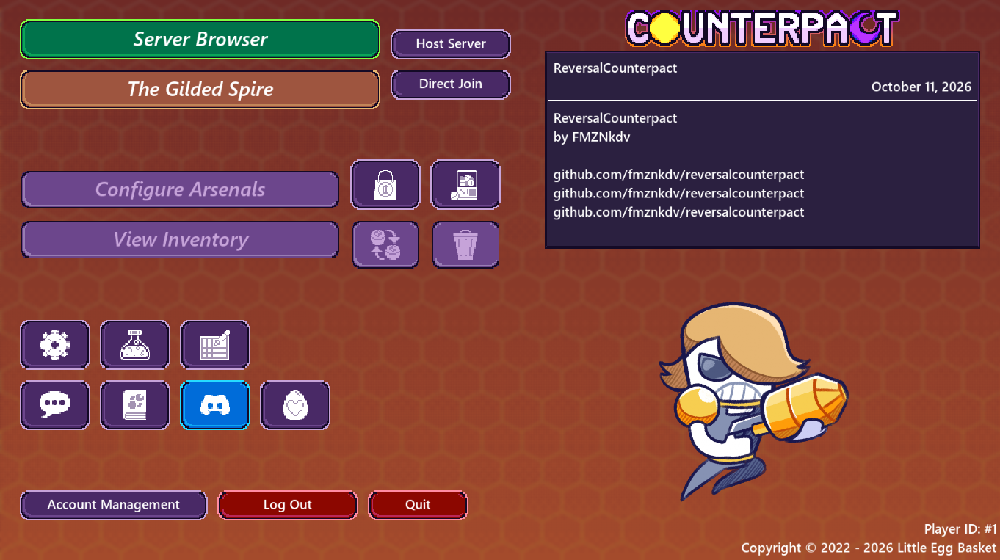

This is the Counterpact server emulator, last version, written in Zig.

# Requirements

- [Zig (0.18.0)](https://ziglang.org/download/)
- Linux
- Brain..? 🧑🏿‍🦯

# Server

## Building

```bash
git clone https://github.com/fmznkdv/ReversalCounterpact
cd ReversalCounterpact
```

## Running

```bash
zig run Master.zig -O ReleaseSmall
```

The server will start listening on `0.0.0.0:21065` by default.

# Client

Download [client from steam](https://store.steampowered.com/app/2061750/Counterpact/) and run in bash:
```bash
LD_PRELOAD=Patch/fmznkdv.so SteamAppId=2061750 "/home/fmznk/.local/share/Steam/steamapps/common/Counterpact/Counterpact.AppImage"
```
